<picture>
  <source media="(prefers-color-scheme: light)" srcset="./assets/hero-light.svg">
  <source media="(prefers-color-scheme: dark)" srcset="./assets/hero-dark.svg">
  
</picture>

  

QA engineer in the Philippines. 
I care about edge cases, clear repro steps, and releases that don't surprise anyone.

  

`playwright` &nbsp;`typescript` &nbsp;`github actions` &nbsp;`manual qa`

  

[repositories ↗](https://github.com/kyujuuuu?tab=repositories)

